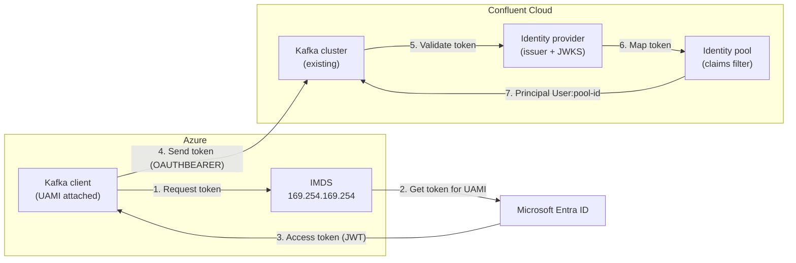
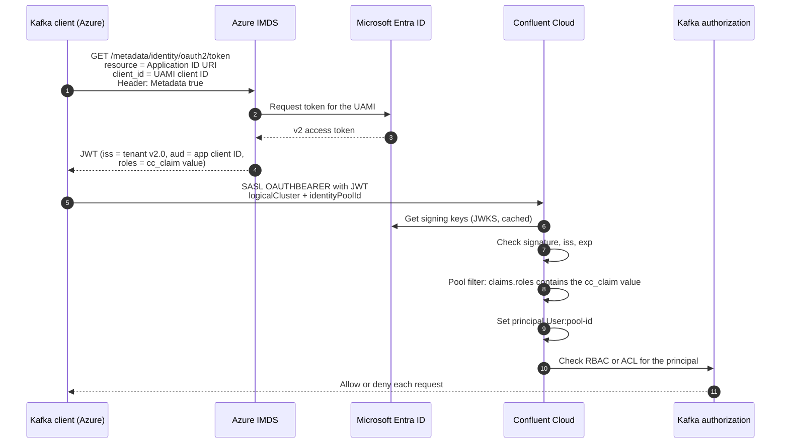

# Azure UAMI with Confluent Cloud

Deploy and test a Kafka client on Azure. The client authenticates to an existing Confluent Cloud cluster. It uses an Azure user-assigned managed identity (UAMI) and OAuth. The client has no stored secret and no Kafka API key.

## How it works



### UAMI authentication flow



The client gets a new token before the old token expires. The client does not store a secret.

This repository creates:

| Root          | Resources                                                                                      |
| ------------- | ---------------------------------------------------------------------------------------------- |
| `azure/`      | Resource group, UAMI, Entra app registration, service principal, optional test VM              |
| `confluent/`  | One identity provider and one identity pool                                                    |

This repository does **not** create or change the Kafka cluster. It does **not** create role bindings or ACLs. See [Grant Kafka access](#grant-kafka-access).

## Requirements

- OpenTofu 1.5 or later, or Terraform 1.5 or later
- Azure CLI, signed in (`az login`). The account must be able to create Entra app registrations.
- A Confluent Cloud API key and secret. The key must have the OrganizationAdmin role.
- An existing Confluent Cloud Kafka cluster and topic
- `jq`, `ssh`, and `scp` on your computer (for the test)

## Repository layout

```
azure/              Azure resources (separate state)
confluent/          Confluent identity provider and pool (separate state)
scripts/            deploy, destroy, and test scripts
Makefile            Short commands for the scripts
```

## Quick start

1. Copy the example variable file and edit it.

   ```bash
   cp azure/terraform.tfvars.example azure/terraform.tfvars
   ```

2. Copy the environment template and edit it. Then sign in to Azure.

   ```bash
   cp .env.example .env
   az login
   ```

   The scripts load `.env` automatically. It holds the Confluent credentials and the Kafka cluster values.

3. Deploy. The command shows each plan and asks for approval two times.

   ```bash
   make deploy
   ```

   After each apply, the script saves the outputs for reference:
   `out/azure-outputs.json` and `out/confluent-outputs.json`. They hold IDs only, no secrets.

4. [Grant Kafka access](#grant-kafka-access) to the new identity pool.

5. Run the test.

   ```bash
   make test
   ```

   The test shows the token claims and then the delivery of one message.

## Configuration

Set these variables in `azure/terraform.tfvars`.

| Variable              | Required | Default                | Description                                                                 |
| --------------------- | -------- | ---------------------- | --------------------------------------------------------------------------- |
| `owner`               | Yes      |                        | Owner user name. Set as a tag on all Azure resources and in the Entra app.  |
| `owner_email`         | Yes      |                        | Owner email address. Set as a tag and in the Entra app notes.               |
| `resource_group_name` | Yes      |                        | Name of the resource group to create.                                       |
| `application_id_uri`  | Yes      |                        | Application ID URI of the Entra app. Use `api://<bootstrap-host>:9092`.     |
| `allowed_ssh_cidr`    | If VM    | `""`                   | Your public IP with `/32`. SSH is open only to this address.                |
| `cc_claim`            | No       | `cc-kafka-clients`     | Required value in the token `roles` claim. See [The cc_claim value](#the-cc_claim-value). |
| `location`            | No       | `westeurope`           | Azure region.                                                               |
| `create_vm`           | No       | `true`                 | Create the test VM. Set to `false` to use your own workload.                |
| `ssh_public_key_path` | No       | `~/.ssh/id_rsa.pub`    | Public key for the test VM.                                                 |
| `uami_name`           | No       | `cc-kafka-client-uami` | Name of the UAMI.                                                           |
| `subscription_id`     | No       | `null`                 | Azure subscription. If not set, `ARM_SUBSCRIPTION_ID` is used.              |

The `confluent/` root takes `entra_tenant_id` and `cc_claim`. `scripts/deploy.sh` supplies both from the Azure outputs.

### The cc_claim value

The identity pool filter checks one condition:

```
'<cc_claim>' in claims.roles
```

`cc_claim` is a text value. It is an app role on the Entra app. The deployment assigns this role to the UAMI. Entra then adds the value to the `roles` claim of each token for the UAMI. Only identities with the role pass the filter. The role exists only on this app, so only tokens for this app carry it.

To give another workload access, assign the same app role to its identity.

The claim name is always `roles`. Entra does not add a custom claim name to a managed identity token, unless you use a claims mapping policy. This repository does not use one.

The account that runs `tofu apply` must be allowed to assign app roles. It needs the Application Administrator role or `AppRoleAssignment.ReadWrite.All`.

### Why the filter uses the role and not `aud`

The `aud` claim is the same in every token for the app. A filter on `aud` cannot tell identities apart. Any identity that gets a token for the Application ID URI matches the filter. A user token for the app has the same `aud` as a managed identity token.

The `roles` claim is different. It holds a value only if you assign the app role to that identity. You control access with explicit role assignments.

| Filter                              | Who matches                                                |
| ----------------------------------- | ---------------------------------------------------------- |
| `claims.aud == "<app client ID>"`   | Every identity with a token for the app                    |
| `'<cc_claim>' in claims.roles`      | Only identities that have the app role                     |

A filter with both conditions is also valid. The `aud` condition adds no protection, because the role exists only on this app. This repository uses the role only.

The app role allows only applications (`allowed_member_types = ["Application"]`). Users and groups cannot hold it. Do not add `"User"`. If you add it, a user with the role passes the filter.

### Several applications or stages

All identities that match one filter share one principal, `User:<pool-id>`. They get the same Kafka permissions. To give different access, use one `cc_claim` value for each application or stage, for example `orders-dev` and `orders-prod`. Each value is one app role and one pool. Grant each pool its own topic access.

This repository supports one `cc_claim` value for each deployment. To use several values:

- Use a separate state and `terraform.tfvars` for each deployment. Change `cc_claim`, `resource_group_name`, `uami_name`, and `identity_pool_name`, so that the names do not collide.
- Or change the code to take a list of values. Create one app role, one role assignment, and one pool for each value.

If you change `cc_claim`, Terraform replaces the app role. Tokens with the old value stop matching. Assign the new role to the UAMI before you test.

### Two values that look alike

| Value                        | Used for                           | Where it goes                  |
| ---------------------------- | ---------------------------------- | ------------------------------ |
| Application ID URI           | The token resource                 | IMDS `resource` parameter      |
| UAMI client ID               | Select the identity                | IMDS `client_id` parameter     |

Do not swap these values.

## Grant Kafka access

A new identity pool has no Kafka permissions. Without them, the client can authenticate but Kafka denies every operation.

1. Get the pool ID: `tofu -chdir=confluent output confluent_identity_pool_id`
2. In Confluent Cloud, grant the principal `User:<pool-id>` access to your topic. A consumer also needs access to its consumer group.

Use your normal process (RBAC or ACL) for this step.

## Use your own workload

Set `create_vm = false` and run `make deploy`. Then attach the UAMI to your workload. The `uami_id` output gives the resource ID. For a Linux VM in Terraform, add this block:

```hcl
identity {
  type         = "UserAssigned"
  identity_ids = [<uami_id>]
}
```

On AKS, make sure the pod, not only the node, can get a token for this UAMI.

Then run `KAFKA_BOOTSTRAP=... KAFKA_CLUSTER_ID=... KAFKA_TOPIC=... scripts/gen-env.sh`. The script writes client settings to `out/`:

- `out/client.env`: values for `produce.py` and `verify-imds.sh`
- `out/client-java.properties`: settings for a Java client

### Java client

1. Add `io.confluent:kafka-client-plugins` version 8.1 or later to the classpath.
2. Use `out/client-java.properties`.
3. Start the JVM with the `-Dorg.apache.kafka.sasl.oauthbearer.allowed.urls=...` flag. The first comment in the properties file gives the exact value. The value must match the token endpoint URL exactly.

### Python client

`scripts/produce.py` is a working example. It uses `confluent-kafka` with `sasl.oauthbearer.metadata.authentication.type=azure_imds`.

## Commands

| Command         | Action                                                       |
| --------------- | ------------------------------------------------------------ |
| `make validate` | Check format and syntax of both roots. No cloud access.      |
| `make deploy`   | Apply `azure/`, then `confluent/`.                           |
| `make test`     | Copy the test files to the VM and run them.                  |
| `make destroy`  | Destroy `confluent/`, then `azure/`.                         |

The scripts use `tofu` if it is installed. Otherwise they use `terraform`.

## Troubleshooting

| Symptom                                    | Action                                                                                                       |
| ------------------------------------------ | ------------------------------------------------------------------------------------------------------------ |
| IMDS returns an error or no token          | Make sure the workload is on Azure and has the UAMI. Make sure `resource` equals the Application ID URI exactly. |
| Confluent rejects the issuer               | Make sure the token `iss` ends with `/v2.0` and has your tenant ID.                                          |
| Confluent rejects the token (`CLAIMS_POOL_FILTER_MISMATCH`) | Run `verify-imds.sh`. Make sure the `roles` claim contains the `cc_claim` value. Make sure the app role is assigned to the UAMI. |
| `roles` is `null`, but the role is assigned | IMDS caches tokens. The cached token is older than the role assignment. Request a new token with `&bypass_cache=true` in the IMDS query, or wait for the cached token to expire. |
| Authentication works, but Kafka denies access | [Grant Kafka access](#grant-kafka-access) to `User:<pool-id>`.                                            |
| Java rejects the endpoint                  | Make sure the `allowed.urls` system property equals the token endpoint URL exactly, with the query string.   |
| Python gets no token                       | Use a `confluent-kafka` version that supports `azure_imds`. The query must contain `api-version`, `resource`, and `client_id`. |
| Works on a VM, fails on AKS                | Test IMDS from inside the pod. A node identity is not the workload identity.                                 |
| `allowed_ssh_cidr` error                   | Set `allowed_ssh_cidr` to your public IP with `/32`, or set `create_vm = false`.                             |

## Security

- Keep Confluent credentials only in `.env` or in environment variables. Do not put them in `.tf` or `.tfvars` files.
- `.env`, `*.tfvars`, state files, and `out/` are in `.gitignore`. Do not commit them. Protect the state.
- The pool filter checks only the `cc_claim` value. Each identity with the app role gets access through the pool. Assign the role to few identities. Do not use `filter = "true"`.
- A bearer token is a credential. Do not log it. Do not paste it into online tools.
- The UAMI does not need an Azure role to get a token. Add roles only if the workload uses other Azure resources.

## Notes

- Use one tool to manage the identity provider. If it already exists, import it into state or create only the pool.
- `make deploy` and `make destroy` have not been run against real accounts. Run `make validate` first.

## References

- [Confluent: Azure UAMI OAuth](https://docs.confluent.io/cloud/current/security/authenticate/workload-identities/identity-providers/oauth/clients/uami.html)
- [Confluent: OAuth identity providers](https://docs.confluent.io/cloud/current/security/authenticate/workload-identities/identity-providers/oauth/identity-providers.html)
- [Confluent: OAuth identity pools](https://docs.confluent.io/cloud/current/security/authenticate/workload-identities/identity-providers/oauth/identity-pools.html)
- [Azure: UAMI in AKS](https://learn.microsoft.com/en-us/azure/aks/user-assigned-managed-identity)
